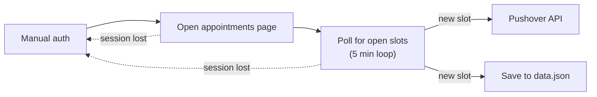

# Appointment Bot

A small Python bot that monitors a specific online appointment page and sends a push notification through the Pushover API the moment an earlier appointment slot opens up.

Appointments were booked months out, but cancellations happened all the time and were taken within hours. Checking by hand wasn't realistic, so I automated it.

> **Note:** This was built for one specific website as a throwaway script. The URLs have been removed, and the page selectors only match that site's HTML, so the script is not runnable as-is. It is here as a portfolio example.

## How it works

1. **Manual auth.** On launch, the bot opens a Chrome window through Selenium, navigates to the login page and waits. You log in, then confirm in the console to continue.
2. **Open appointments page.** The bot opens the appointments page. If the site redirects somewhere else, that is treated as an expired session: it sends a "session lost" alert and goes back to manual auth. Handling other errors was out of scope, so they simply stop the bot.
3. **Poll for open slots.** The bot runs in a 5-minute loop. In each loop, it goes through every available appointment and checks whether it meets these requirements:
    - Appointment doctor matches `doc_name`
    - Appointment date is < `before_date`
    - Appointment doesn't exist in `data.json`

    After finding an appointment slot, the bot keeps polling for other appointments until manually stopped.
4. **Pushover API.** Each new appointment is sent as a push notification to connected devices.
5. **Save to data.json.** Found appointment slots are saved to `data.json`. Slots already in the file are skipped, so the same slot never triggers two alerts.

Pressing `Ctrl+C` while the bot is polling returns to manual auth. Pressing it again at the login prompt quits and closes the browser.

## Design choices

| Piece | Choice | Why |
|---|---|---|
| Browser automation | Selenium | The authentication step required a full browser for OAuth and 2FA. A hand-off to `requests` after login would probably have worked, but was out of scope. |
| Authentication | Manual login, then the bot takes over | `PHPSESSID` in cookies was the method of authenticating. From testing, I found that they were probably using `session.gc_maxlifetime` with default settings, where 24 minutes of inactivity deletes the session, so a 5-minute loop was plenty to keep the session alive. |
| Parsing | BeautifulSoup on `page_source` | Simpler to use than chained Selenium element lookups. |
| Notifications | Pushover HTTP API | The best solution I could find at the time for instant push notifications to any device with a single POST request. |
| State | Local JSON file | A simple way to keep state between loops and instances. Its main purpose was to prevent duplicate notifications, and there wasn't enough data to warrant anything more sophisticated. |
| Terminal UI | colorama + in-place line rewriting | Just to make things look ✨pretty✨. |

## Outcome

New appointments were usually about two months away. With the bot, I consistently got slots less than a week out, with very little maintenance: just a restart or a new login every couple of days.

Most new slots appeared around weekends or just before the start of the week, when people tended to cancel.

## Tech

Python 3 · Selenium · BeautifulSoup4 · colorama · Pushover API · python-dotenv
